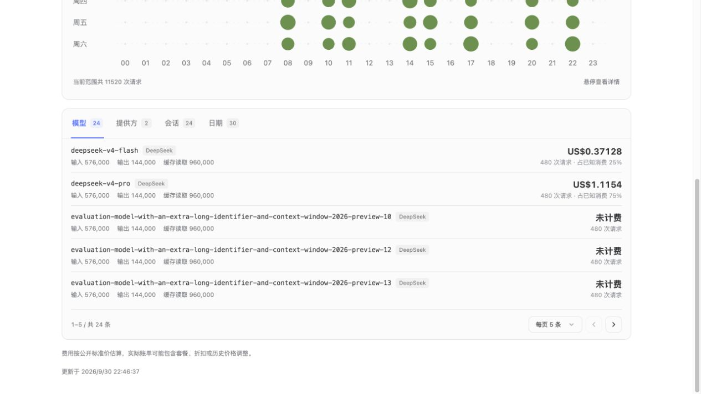

# dsh-balance

[简体中文](./README.md) | [English](./README_EN.md)

A DeepSeek Harness plugin for checking DeepSeek / StepFun API balances, plus available models and multidimensional usage costs for DeepSeek / StepFun / Tokener. The API key is used only by the local Host and is never sent to the browser.

The redesigned account ledger switches between DeepSeek, StepFun, and Tokener. Run `pnpm preview` to explore it with sample data.

The composer readout follows the current session’s provider and model. The Settings provider selection is independent.

## Features

- DeepSeek: total, topped-up, and granted balances
- StepFun: available balance, total cash credited, total vouchers granted, and prepaid / postpaid account type
- Tokener: local requests/tokens grouped by provider, model, session and date, USD estimates from its published catalog, and models from `/v1/models`
- Independent provider caches and case-insensitive Provider IDs
- Show the current provider, model, and balance below the composer, following both the selector and `/model`
- Fetch available models, owners, and creation dates from the selected provider’s `/models` API
- View actual usage costs by selected provider, model, session, and day in Settings, plus request details in the current session's Usage tab
- Mark missing usage, unknown providers, and unknown models as unpriced without estimating tokens
- Group dates in the browser's IANA timezone while applying DeepSeek peak pricing in Beijing time, Monday–Friday only, with Chinese public holidays all-day off-peak
- Show native USD and CNY costs separately; `usdToCny` enables a combined CNY total
- Cache query results with manual refresh support
- Annotate the model list with catalogued reference rates (input/output per million tokens); models without published pricing are marked explicitly
- Drill from the Sessions category into any session's full request breakdown and back to the overview
- Export the current view as JSON or CSV (overview: full summary or the visible category; session: request-level records) — data never leaves the machine
- Enter a display-only USD→CNY rate on the usage page (kept in browser localStorage, no restart); the plugin's `usdToCny` config still takes precedence
- Replace built-in prices with `pricingOverrides` (matched by provider + model, optional `effectiveFrom`); the model list and usage estimates follow
- Show a recent balance trend (the last 48 in-process observations) in Settings and optional per-currency low-balance warnings (`lowBalance`), mirrored below the composer
- Custom date ranges and twelve common time zones (browser default); month-to-date projection at the current pace, plus a comparison with the immediately preceding period for bounded ranges
- Retry balance and model queries on 429 / 5xx (honoring `Retry-After`, exponential backoff, at most three attempts)
- Follows DeepSeek peak/off-peak pricing: the balance indicator below the composer turns orange during peak hours (09:00–12:00 and 14:00–18:00 Beijing time, Monday–Friday, excluding Chinese public holidays)
- Native Simplified Chinese and English that follows the Harness system language
- Use the `DEEPSEEK_API_KEY` saved by Harness

## Compatibility

Starting with 0.13.1, the plugin declares the broad DSH range **`>=0.2.2-rc.1 <1.0.0-0`**. Use Node.js **24.9+**. `engines.dsh` and every DSH peer use the same range. DSH includes prereleases in its compatibility checks, so later 0.x RCs, patches, and minor versions are not rejected solely because their version changed. The Cordis peer range is `^4.1.0`. Development dependencies remain pinned to DSH `0.2.2-rc.1` and Cordis `~4.1.0` for reproducible builds. Runtime validation covers [DSH 0.2.2-rc.1](https://github.com/deepseek-ai/deepseek-harness/releases/tag/dsh-v0.2.2-rc.1); the broad declaration does not mean future versions have been runtime-tested, and upstream API changes may still require adaptation. Harness `0.2.0-rc.2` users should keep plugin `0.10.2`; Harness 0.1 APIs are no longer supported by this checkout.

To install from source, build and pack it locally, then pass the generated `.tgz` path to `dsh plugin --profile web add /absolute/path/to/package.tgz` and restart Harness:

```bash
pnpm install --frozen-lockfile
pnpm pack
```

Usage reads the current read-only session handles and excludes fork-inherited events using `inheritedEventCount`. The conversation tab refreshes when token usage changes or a turn finishes.

Global statistics skip sessions that the current dsh cannot read, such as unsupported historical formats or damaged logs, and show how many sessions were excluded. Partial summaries are retried on the next refresh; unchanged successful sessions reuse compact usage records while failed sessions are retried. An unreadable selected session, or a collection where every session fails to read, still reports an error instead of showing zero usage.

Usage breakdowns use counted tabs for models, providers, sessions, and dates, with a themed category selector on narrow screens. Lists default to 10 rows per page, with 5 / 10 / 20 options. The conversation page separates model summaries and requests, and requests can be filtered by model. Long names are truncated with their full value available on hover.



Since `0.12.1`, usage queries read one session log at a time across all HTTP requests, extract compact request metadata, and release the full log before continuing. Concurrent reads of the same session are shared. Unchanged successful sessions reuse revision-keyed usage records even when another session is unreadable; explicit refresh re-reads logs. Cached records exclude message bodies and tool output, preventing full-history retention and overlapping scans from exhausting the JavaScript heap.

## Install

```bash
npm install -g @deepseek-ai/dsh@latest
dsh plugin --profile web add @pinkbanana/dsh-balance@latest
dsh --profile web
```

Open <http://127.0.0.1:3080/> and go to Settings → Model Balances. The panel sits directly below Agent presets, and the balance summary also appears below the composer in existing sessions. Save the API key in Settings → Models or provide it through the `DEEPSEEK_API_KEY` environment variable.

Usage statistics read persisted session logs, including writes visible from active sessions. Prompt content is never exposed. To show a fixed-rate CNY conversion, add for example:

```yaml
usdToCny: 7.2
```

Per-currency low-balance thresholds (case-insensitive currency) surface warnings in Settings and below the composer:

```yaml
lowBalance:
  - currency: CNY
    amount: 20
  - currency: USD
    amount: 5
```

Replace built-in prices with custom rates (a complete USD or CNY triple is required; `effectiveFrom` is optional and defaults to immediate; restart Harness after changing them):

```yaml
pricingOverrides:
  - provider: deepseek
    model: deepseek-v4-flash
    cacheMissUsdPerMillion: 0.10
    cacheHitUsdPerMillion: 0.01
    outputUsdPerMillion: 0.30
  - provider: stepfun
    model: step-5-preview
    effectiveFrom: "2026-11-01T00:00:00Z"
    cacheMissCnyPerMillion: 6
    cacheHitCnyPerMillion: 0.3
    outputCnyPerMillion: 18
```

Overrides apply to both the model-list annotations and usage estimates; models without an override keep their built-in rates. Besides `usdToCny`, the usage page also accepts a display-only rate stored in this browser; the plugin configuration wins when present.

Both the official provider ID `deepseek-official` and legacy `deepseek` are supported case-insensitively and share DeepSeek credentials, balance caches, and model caches. The composer retains the actual model ID; use `deepseek-flash` (legacy names `deepseek-v4-flash` and `deepseek-v4-flash-vision-exp`, as well as `deepseek-chat` / `deepseek-reasoner`, are billed at the current official Flash rates). New models with unknown pricing remain unpriced.

## Tokener configuration and usage

Add a custom provider in Settings → Models with ID `Tokener` (case-insensitive; `tokener.ai` is also accepted), base URL `https://api.tokener.ai/v1`, and your API key. The default credential reference is `TOKENER_API_KEY`; it can be overridden:

```yaml
providers:
  - id: tokener
    apiKeyRef: TOKENER_API_KEY
    baseUrl: https://api.tokener.ai/v1
```

The Host queries the documented `GET /v1/models` with Bearer authentication; credentials never reach the browser. [Tokener's API documentation](https://www.tokener.ai/zh/docs/reference/api-endpoint) does not publish an API-key balance or organization-usage endpoint. Settings link to the console, and the composer points to Usage Statistics without querying an undocumented endpoint.

Statistics cover locally saved dsh sessions only, not other clients or organization-wide usage, and do not group by API key. Requests and tokens are grouped by provider, model, session, date and activity hour. DSH usage already separates cache reads from uncached input; the plugin does not count them twice.

Conversation/reasoning model estimates use the [Tokener model catalog](https://www.tokener.ai/zh/models) USD reference snapshot checked on 2026-11-03, matching exact model IDs without vendor rates or DeepSeek peak multipliers. This snapshot also estimates older records; it does not reconstruct historical charges. Unknown models, missing usage, and requests with unpublished cache-write pricing retain their requests/tokens but stay unpriced. Account balances and actual bills remain in the [Tokener console](https://console.tokener.ai).

New dsh versions validate compatibility before installation and startup. Older plugin releases pin exact DSH versions and can be rejected after a DSH upgrade; update to plugin `0.13.1` and restart Harness. No version exemption is required within the declared range. Versions below `0.2.2-rc.1`, and 1.0.0 prereleases or newer, remain outside the range. Keep plugin `0.12.1` on dsh `0.2.1-rc.5`, or plugin `0.11.0` on dsh `0.2.1-rc.2`.

## StepFun setup

Add a custom provider in Settings → Models with Provider ID `StepFun` (`stepfun`, `STEPFUN`, and other case variants work) and save its API key. Harness derives the credential reference `STEPFUN_API_KEY`; setting that environment variable also works. Select StepFun in Settings → Model Balances.

The [StepFun account API](https://platform.stepfun.com/docs/zh/api-reference/accounts/get) uses Bearer authentication at `GET https://api.stepfun.com/v1/accounts`. Amounts are shown in CNY. Cash and voucher totals are cumulative amounts as documented, not remaining balance components. The API does not report service availability, so a zero or negative postpaid balance is not labeled as unavailable service.

To use another credential reference, override the balance provider in this plugin's configuration (`baseUrl` is an API prefix; include `/v1` for StepFun):

```yaml
providers:
  - id: StepFun
    apiKeyRef: MY_STEPFUN_KEY
    baseUrl: https://api.stepfun.com/v1
```

Existing top-level `apiKeyRef` / `baseUrl` settings continue to serve DeepSeek. The `providers` entries override both balance and model queries. Custom model base URLs are not read automatically; balance queries default to official APIs. Balances, models, and Settings usage follow the selected provider. The composer follows the live session selection; the session Usage tab preserves historical usage across all providers.

Model lists use the [StepFun list API](https://platform.stepfun.com/docs/zh/api-reference/models/list) at `GET /v1/models`, parsing `id`, `owned_by`, and `created` (Unix seconds) from each [Model object](https://platform.stepfun.com/docs/zh/api-reference/models/object). These fields are already returned in the list, so individual model retrieval is unnecessary. The Host route is `GET /dsh-balance/api/models?provider=StepFun`, with isolated provider caches and `refresh=1` to force a refresh.

## Usage accounting

Each request is attributed to its actual message source, with request headers as a fallback for older logs. Request time determines date grouping and peak pricing. Token totals include uncached input, output, cache reads, and cache writes. Settings defaults to the selected provider, with an All providers option; the session view keeps mixed-provider history.

Built-in estimates use [official DeepSeek USD rates](https://api-docs.deepseek.com/quick_start/pricing/): current Flash off-peak prices are $0.003 / $0.15 / $0.60 per million tokens (cache hit / miss / output), and peak is 2x. Peak hours are 09:00–12:00 and 14:00–18:00 Beijing time (UTC 01:00–04:00 and 06:00–10:00), Monday–Friday only; weekends and Chinese public holidays are all-day off-peak. Holiday dates follow the 2026 arrangements in [State Council General Office notice 国办发明电〔2025〕7号](https://www.gov.cn/zhengce/zhengceku/202511/content_7047091.htm). Current Flash prices take effect from 2026-09-10 04:00 UTC; earlier usage keeps the 2026-08-17 historical tier (the current official page no longer lists those figures, so they cannot be re-verified).

[StepFun mainland CNY reference rates](https://platform.stepfun.com/docs/zh/guides/pricing/details) were re-checked on 2026-11-10 for `step-5-preview`, `step-3.7-flash`, `step-3.5-flash`, `step-3.5-flash-2603`, and `step-1o-turbo-vision`. The standard `step-5-preview` cache-hit price changed from 0.35 to 0.70 CNY per million tokens at 2026-10-14 00:30 Beijing time. Accounts that had already used the pay-as-you-go API before that time may keep 0.35; the plugin cannot detect that grandfathering, so it applies the standard effective-from date. Requests without supported pricing keep their token and request counts and show as unpriced. A similarly named DeepSeek model does not inherit official DeepSeek pricing on another provider. Entirely unpriced totals do not show $0; mixed totals include only known charges and carry a partial-cost label. Live account balances are separate from local usage estimates.

## Extension and design

- `src/providers.ts` holds shared provider metadata. The adapter table in `src/balance.ts` defines endpoints and response parsers; transport, errors, and caching are shared.
- `GET /dsh-balance/api/balance?provider=StepFun` selects StepFun. Omitting provider preserves DeepSeek compatibility; `refresh=1` bypasses that provider's cache. Unknown providers return `UNSUPPORTED_PROVIDER`.
- The layout draws on [Codrops' Kononenko case study](https://tympanus.net/codrops/2026/09/18/kononenko-architectural-bureau/): oversized type, negative space, architectural grids, and geometric linework, implemented in original CSS with light/dark themes, narrow layouts, and reduced-motion support.

## Development

```bash
pnpm install
pnpm check
pnpm preview
```

The preview uses no real credentials. Use `?lang=en&theme=dark` for English/dark mode, or `?state=missing`, `error`, `empty`, or `loading` to inspect those states. The sample model selector also exercises the composer readout. StepFun balance and model queries and the redesigned account page are available starting with `0.6.0`. Live model balances, and usage accounting fixes are available starting with `0.7.0`.

## License

[MIT](./LICENSE)

<a href="https://www.buymeacoffee.com/pinkbanana"></a>

## Native usage page

A **Usage Statistics** entry below **Plugins** in the native sidebar opens a standalone page. It defaults to all providers and all time, with provider/date-range filters and breakdowns by provider, model, session, and day. Native `sidebar.panellist` and `main` slots keep navigation, collapsed sidebar behavior, and active styling consistent with Harness. Plugin surfaces use Harness theme colors and radii.

Usage includes completed messages and failed, retried, or cancelled attempts with a reported stream usage sample. The final sample wins within an attempt; retry boundaries count separate calls. Inherited fork events are excluded. Open statistics refresh every 15 seconds and on focus/visibility return, without polling hidden pages. Manual refresh also populates the normal revision cache. Unknown prices remain unpriced.

Run `pnpm preview` and open `?page=usage` (or `?page=usage&lang=en&theme=dark`) to inspect the fixture page.

The activity punchcard groups requests by weekday and hour in the selected browser timezone. Dot area tracks request counts and follows provider/date filters, including DST repeated hours. Hover or use arrow keys for request/token details. Filters use themed, portaled listboxes with keyboard navigation, selection checks, Escape/outside-click dismissal, and typeahead.

### v0.10.0 usage accounting

The conversation usage view has centered content, responsive padding and space for the composer. Cache input is counted once; duplicate settlements replace the previous sample, retries remain separate, and fork prefixes are excluded.

StepFun mainland API estimates use [official standard CNY rates](https://platform.stepfun.com/docs/zh/guides/pricing/details), re-checked on 2026-11-10, for `step-5-preview`, `step-3.7-flash`, `step-3.5-flash`, `step-3.5-flash-2603`, and `step-1o-turbo-vision`. The standard `step-5-preview` cache-hit rate is 0.70 CNY per million from 2026-10-14 00:30 Beijing time; earlier records use 0.35. These reference estimates do not account for plans, discounts, grandfathered account rates, or unrecorded historical rate changes. USD and native CNY are shown separately; only an explicitly configured `usdToCny` rate enables a combined CNY total. Unknown rates remain unpriced. `?page=session` previews the conversation view with 124 StepFun requests.
